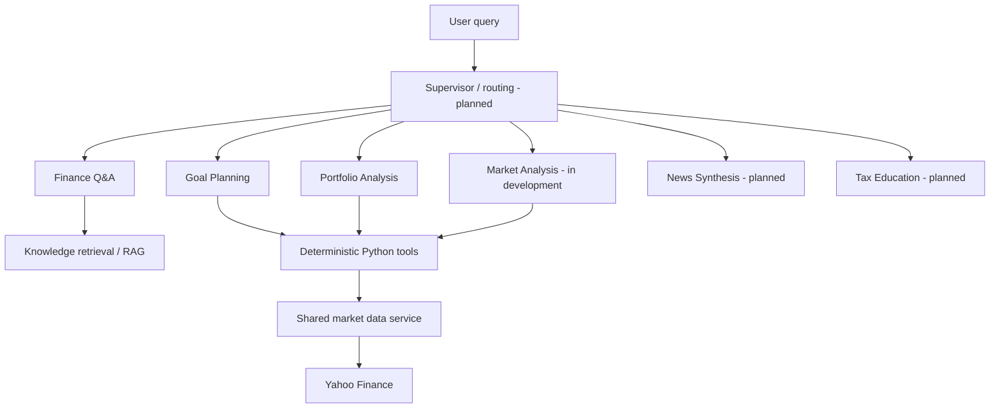

# AI Finance Assistant

An ongoing personal applied AI research and engineering project exploring reliable, tool-augmented multi-agent systems for financial intelligence.

## Problem and objective

Financial questions often require combining domain knowledge, current external data and precise numerical calculations. Standalone LLMs can produce unsupported claims or incorrect arithmetic. This project explores a hybrid architecture that separates language reasoning, retrieval and deterministic computation, with the goal of improving reliability, explainability and extensibility.

## Architecture



The supervisor is a target architecture, not an implemented integration. Existing agents can be invoked independently.

## Implementation status

| Component | Status | Capabilities |
|---|---|---|
| Finance Q&A | Working prototype | Financial knowledge retrieval and grounded answers |
| Goal Planning | Working prototype | Deterministic financial planning calculations |
| Portfolio Analysis | Working prototype | Valuation, allocation, HHI and concentration analysis |
| Market Analysis | In development | Historical returns, volatility, drawdown and moving averages |
| News Synthesis | Planned | Source-grounded news summaries |
| Tax Education | Planned | Retrieval-grounded tax information |
| Supervisor | Planned | Intent routing, task decomposition and coordination |

Three of six specialized agent prototypes have been reported working in local tests. This is a development milestone, not a measured accuracy or production-readiness claim.

## Technical design decisions

- **Hybrid reasoning:** LLMs interpret requests, select tools and explain outputs; Python performs numerical calculations.
- **RAG:** Retrieve relevant domain knowledge rather than relying exclusively on model parameters. Retrieval configurations will be benchmarked.
- **Structured tool calling:** Typed interfaces constrain tool inputs and support independent validation.
- **Shared services:** Portfolio and market analytics reuse a provider-facing market data module, reducing duplication.
- **Data semantics:** Portfolio valuation uses unadjusted daily prices; historical performance uses adjusted prices to account for corporate actions. Prices are not guaranteed live quotes.
- **Explainability:** Return structured metrics, price dates and sources; distinguish concentration from overall investment risk.

## Quantitative methodology

For holdings with quantity $q_i$ and price $p_i$:

- Portfolio value: $V=\sum_i q_i p_i$
- Allocation: $w_i=q_i p_i/V$
- Concentration (HHI): $\sum_i w_i^2$
- Effective holdings: $1/HHI$
- Prototype diversification score: $100(1-HHI)$

The diversification score and concentration thresholds are illustrative heuristics, not validated investment risk ratings. Historical analytics under development include adjusted-price returns, annualized daily-return volatility (assuming 252 trading days), maximum drawdown and moving averages.

## Research and evaluation roadmap

Planned experiments compare model choices, prompt strategies, retrieval configurations and single-agent versus supervisor-led and deterministic routing baselines. Use a fixed, labeled evaluation set, separate development and held-out test cases, and report per-task results, failure categories, latency and token cost. Test numerical outputs against independent reference calculations and assess groundedness against source evidence.

| Metric | Proposed target | Evaluation approach |
|---|---:|---|
| Numerical accuracy | 100% | Reference calculations with defined tolerances |
| Tool-selection accuracy | >=95% | Labeled expected tools |
| Retrieval Recall@5 | >=90% | Annotated relevant documents |
| Factual groundedness | >=95% | Supported factual claims / assessed claims |
| Hallucination rate | <=5% | Unsupported factual claims / assessed claims |
| End-to-end task success | >=90% | Task-specific acceptance criteria |
| Latency and inference cost | Benchmark | p50/p95 latency and cost per completed task |

These are proposed targets, not achieved results. No comparative benchmark results are claimed yet. Future work includes caching, retries, fallback behavior, execution tracing, prompt-injection defenses and evaluation of tool failures.

## Technology stack

Python, LangChain, OpenAI, RAG, Pandas, yFinance; LangGraph-based supervisor orchestration planned.

## Local setup

Clone the repository and create a virtual environment (Windows PowerShell):

```powershell
git clone https://github.com/prateshj/ai-finance-assistant.git
cd ai-finance-assistant
python -m venv .venv
.\.venv\Scripts\Activate.ps1
```

Install dependencies from the project's requirements file if present (`python -m pip install -r requirements.txt`). Otherwise, the known components use `langchain`, `langchain-openai`, `python-dotenv`, `pandas` and `yfinance`; retrieval may require additional dependencies. Configure `OPENAI_API_KEY` locally and optionally `OPENAI_MODEL`. Never commit credentials or `.env` files.

### Example: portfolio agent

```powershell
python -m agents.portfolio_agent
```

Example input: `I own 100 shares of Reliance, 50 shares of TCS and 200 shares of HDFC Bank. Analyze my portfolio.`

Expected output includes valuation in INR, allocations, HHI, effective holdings, diversification score, concentration risk and price dates. Actual values depend on market data. The current portfolio prototype supports NSE equities only.

## Limitations

Research prototype; not a production financial advisory system. External data may be delayed or unavailable. Concentration is not overall risk. Evaluation, orchestration and production resilience remain under development. Not intended as investment advice.
